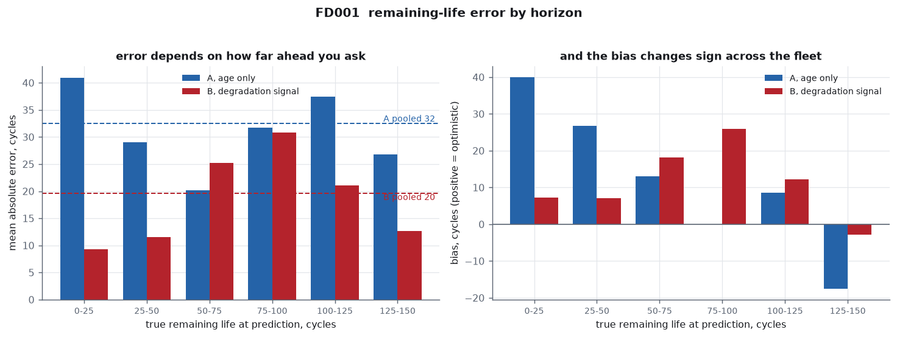
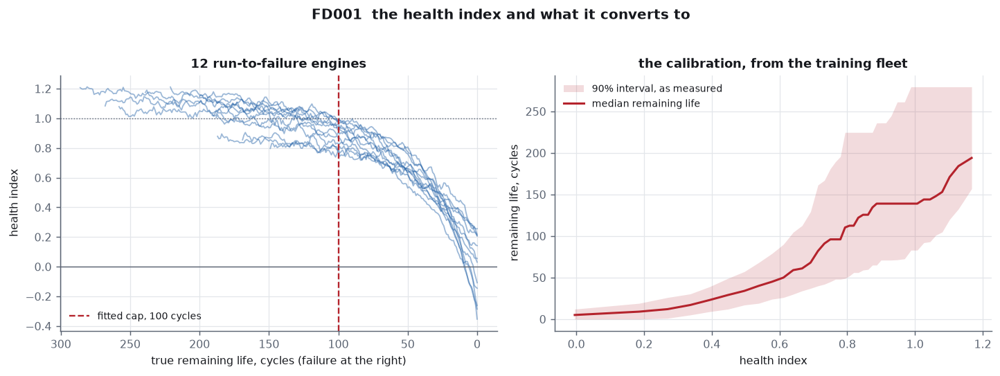
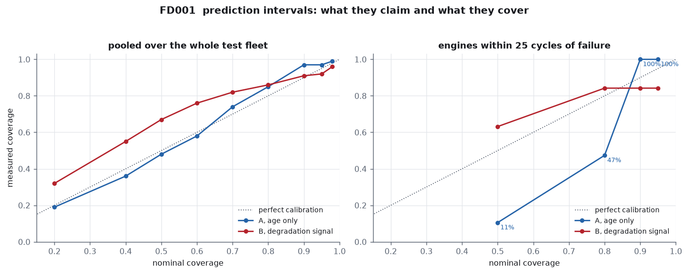
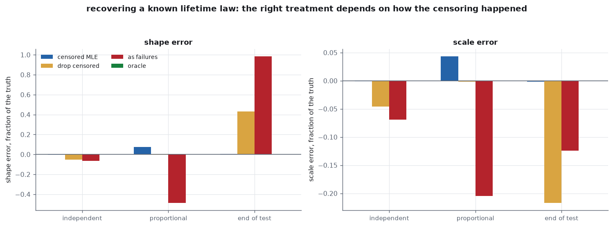
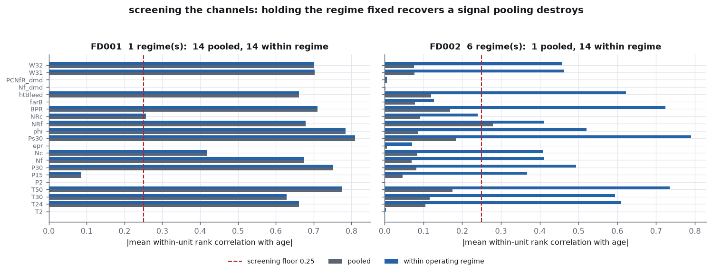
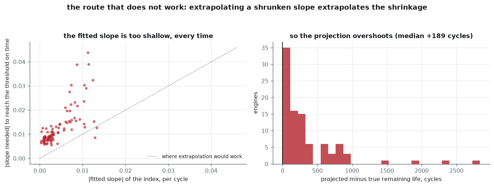

# Remaining Useful Life

Predicting how many cycles a jet engine has left, on NASA's C-MAPSS
run-to-failure fleets, with two independent estimators that are allowed to
disagree and an evaluation that refuses to average the disagreement away.

The short version: **a single error number for a fleet is close to
meaningless, because remaining-life accuracy depends almost entirely on how
far ahead you ask.** On FD001 the sensor-driven estimator is **4.4 times more
accurate than the age-only one on the engines within 25 cycles of failure**
(9.3 cycles against 41.0) — and the age-only estimator's nominal 50%
prediction interval covers **11%** of those engines while covering 48% of the
fleet pooled. Both numbers are measured, not intended, and both are in the
report as they came out.



```
python run.py              # fetch, fit, evaluate, chart, report  (~1 min)
```

```
python run.py --refresh    # re-fetch and re-parse the archive
```

```
python -m pytest tests/    # 80 tests
```

Output: `out/report.pdf`, fifteen pages composed in matplotlib.

---

## The data, and what the archive gets wrong about itself

NASA's Commercial Modular Aero-Propulsion System Simulation study: four
fleets of simulated turbofans run to failure, each with a second set of
engines whose records stop early and whose true remaining life is supplied
separately. That is what makes the dataset worth using — the censored half is
genuinely censored, and predictions about it can still be scored against
truth.

The canonical NASA URL no longer serves the file; it redirects to a landing
page with no download on it. The copy used here is the **PHM Data Challenge
S3 mirror**, and the SHA-256 digests of both zip layers are pinned in
`src/data.py`, so a substituted mirror fails loudly instead of quietly
changing the numbers.

Checking the parse against the archive's own readme rather than trusting it
turned up an error in the documentation:

| subset | train found | test found | train in readme | test in readme | |
|---|---:|---:|---:|---:|---|
| FD001 | 100 | 100 | 100 | 100 | agrees |
| FD002 | 260 | 259 | 260 | 259 | agrees |
| FD003 | 100 | 100 | 100 | 100 | agrees |
| FD004 | **249** | **248** | 248 | 249 | **readme is wrong** |

`RUL_FD004.txt` settles it with 248 values, one per test unit. The readme has
the pair transposed. The operating-regime counts are recovered from the
settings rather than assumed, and those do agree with the documentation: one,
six, one, six. Within a regime the throttle is held exactly constant and the
altitude and Mach settings carry about 0.003 and 0.0006 of dither, so the
regimes are discrete flight conditions and not fuzzy clusters.

## Two estimators of the same quantity

**A, the fleet lifetime law** (`src/agelaw.py`). Told an engine's age and
nothing else. A two-parameter Weibull fitted by right-censored maximum
likelihood — shape 4.41, scale 225 cycles on FD001 — inverted in closed form
to a conditional remaining life given survival to the current age. Two engines
of the same age always get the same answer, so its error has a floor set by
the spread of the lifetime distribution itself. It is deliberately the weaker
estimator, and it is the floor the second one has to beat.

**B, the degradation signal** (`src/degradation.py`). Never told how long an
engine lives. The sensor channels are reduced to one health index by least
squares against a target that sits at 1 while the engine is healthy and falls
to 0 at failure, the index is smoothed causally, and it is converted back to
cycles through the **empirical conditional distribution of true remaining
life given health**. The interval is that measured spread, not a variance
formula.



The target needs a cap, because degradation has an onset: an engine does not
begin dying at cycle 1, and a target declining from the first cycle asks the
regression to find a trend that is not there. The cap is **estimated rather
than taken from the literature's usual 125**, by two criteria that could
disagree and do not — the cap at which the index lands on 1 healthy and 0
dead without being asked to, and the cap maximising fit quality. Both pick 100
cycles on FD001.

Read physically, that cap is the horizon over which these instruments say
anything at all. Beyond roughly a hundred cycles from failure they do not
distinguish an engine with 150 cycles left from one with 250.

### Where they disagree

| true RUL | n | A, age only | B, degradation | closer |
|---|---:|---:|---:|---|
| 0–25 | 19 | 41.0 | 9.3 | degradation |
| 25–50 | 11 | 29.0 | 11.5 | degradation |
| 50–75 | 13 | 20.2 | 25.2 | **age law** |
| 75–100 | 23 | 31.8 | 30.8 | degradation |
| 100–125 | 23 | 37.5 | 21.0 | degradation |
| 125–150 | 11 | 26.8 | 12.6 | degradation |
| all | 100 | 32.5 | 19.6 | degradation |

They disagree by 30 cycles on average and their predictions correlate at only
+0.68, so they are not two tunings of one model. Close to failure the
degradation signal is 4.4 times more accurate, and that is the band with
consequences attached. Its advantage is about two to one out to fifty cycles,
and then it collapses: beyond fifty the two sit within a factor of two of each
other and **the age law takes one or two bands on every one of the four
fleets, but never the same ones**. That is what the detectability horizon
looks like from the outside.

## The honest evaluation



Pooled over the test fleet both estimators look broadly calibrated — the age
law's nominal 90% interval covers 97%, the degradation signal's 91%.
Conditioning on the horizon takes that picture apart, and it does so in two
different ways on different fleets:

* On **FD001**, the age law's nominal 50% interval covers **11%** of the
  engines within 25 cycles of failure, its nominal 80% covers 47%, and its
  nominal 90% covers 100%. The prediction is so far off that only the widest
  interval catches the truth at all, and it catches everything.
* On **FD004**, the same nominal 90% interval covers **53%** of them.

Neither is calibration. The intervals are the wrong shape rather than
uniformly too wide or too narrow, and pooling averages an interval that misses
almost everything near failure against one that contains almost everything
elsewhere, which comes out looking respectable.

The comparison holds on all four fleets:

| subset | A near failure | B near failure | A pooled | B pooled | A cover 90% near | A cover 90% pooled |
|---|---:|---:|---:|---:|---:|---:|
| FD001 | 41.0 | 9.3 | 32.5 | 19.6 | 100% | 97% |
| FD002 | 38.8 | 6.4 | 33.1 | 21.5 | 84% | 93% |
| FD003 | 65.8 | 7.0 | 48.9 | 28.6 | 73% | 96% |
| FD004 | 68.3 | 10.6 | 49.9 | 30.7 | 53% | 86% |

## Censoring, and the result that came out backwards

Half of each pooled fleet is right-censored. The textbook says to use the
censored likelihood; the measurement disagreed, and diagnosing why is the most
useful thing in the project.

| treatment | shape | scale | prediction MAE | bias |
|---|---:|---:|---:|---:|
| censored MLE | 4.82 | 236.6 | 37.1 | +21.4 |
| drop censored | 4.41 | 225.0 | 32.5 | +12.3 |
| as failures | 2.93 | 188.8 | **27.9** | −9.2 |
| *oracle* | *4.55* | *224.8* | *32.5* | *+12.0* |

Discarding the censored units, supposedly the blunder, comes closest to the
oracle, and the correct likelihood is biased long. Simulation from a planted
truth explains it: **C-MAPSS cuts each test record at a random fraction of its
own life**, so the cut-off correlates with the true lifetime at **+0.65**
(p = 2.6e-13), which is precisely what non-informative censoring rules out.
And because the censored units are a random half of a fleet whose lifetime
distribution matches the half retained, discarding them costs precision and
biases nothing.

This is not a licence to drop censored data. Under the censoring an operator
actually faces — a common cut-off, where the censored engines are the
long-lived tail — the same shortcut recovers a shape **43% too high** and a
scale **22% too low**, while the censored MLE stays within half a per cent.



A second inversion is worth stating plainly: ranking the treatments by
downstream prediction error reverses the ranking by parameter accuracy.
Counting survivors as failures gives much the worst fit and the *best*
predictions, because two errors partially cancel. Downstream error cannot
decide whether censoring was handled correctly; that question is settled on
the parameters, against a planted truth.

## Which sensors carry signal, and where



Screening the twenty-one channels by how strongly each moves with age gives
two different answers depending on whether the operating regime is held fixed.
On the six-regime subsets, **pooled screening finds one usable channel out of
twenty-one** — no correlation in FD002 exceeds 0.28 — and the fleet looks as
though it has almost no degradation signal in it. Holding the regime fixed
recovers **fourteen**. Moving the engine between six flight conditions swings
every sensor by far more than degradation does, so pooling buries a real
monotone drift under a much larger between-regime variance.

A second finding came from a channel that refused to stay excluded. The engine
pressure ratio is exactly flat in FD001 and FD002 and trends at +0.31 and
+0.21 in FD003 and FD004 — the two subsets that degrade the fan as well as the
compressor. **Channel usefulness depends on which fault is growing, not only
on how the engine is flown**, and a sensor set chosen on FD001 would discard
the channel that marks the second failure mode.

## The route that does not work



The obvious thing to do with a declining health index is to fit its slope and
project it to the failure threshold. It is kept in the module and in the
report because its failure is a measured result rather than an opinion: the
fitted slope comes out too shallow by a factor of 3.6 at the median, and by
more than five on a quarter of the fleet.

Not because of noise — the index carries a per-cycle noise of about 0.042
against an eleven-cycle mean. The cause is **attenuation**: the index is a
regression estimate of health, so it is shrunk toward the fleet mean, and a
shrunken signal has a shallower slope than the quantity it estimates.
Extrapolating a shrunken slope extrapolates the shrinkage. Calibrated
inversion fixes it, because the calibration is fitted on the same shrunken
index it is applied to.

## Planted truth

Simulated fleets with a known health law, a known detectability horizon and
known useless channels check that the estimator finds what is actually there.

| sensor noise | cap found | index R² | MAE inside horizon | cover 90% |
|---:|---:|---:|---:|---:|
| 0.10 | 100 | 0.995 | 2.9 | 96% |
| 0.25 | 100 | 0.969 | 5.4 | 96% |
| 0.60 | 120 | 0.845 | 9.2 | 94% |
| 1.50 | 120 | 0.459 | 16.0 | 96% |
| 3.00 | 120 | 0.169 | 26.8 | 94% |

The true horizon is 100 cycles. With a clean signal it is recovered exactly
and remaining life is predicted to within three cycles. The last row is the
useful one: at noise 3.0 the index explains little and the error is 27 cycles,
so the method has stopped working — and says so through its intervals rather
than through a confident wrong number.

## What this does and does not establish

**Established.** Remaining-life error depends so strongly on the horizon that
a pooled figure misdescribes both ends of a fleet, and pooled coverage can look
calibrated while the intervals are badly overconfident exactly where decisions
are made. A sensor-driven estimator is several times more accurate than an
age-only one close to failure, and within a factor of two of it beyond fifty
cycles. Which sensors carry signal depends on the operating regime and on the
fault mode, so a channel selection is not transferable between fleets of the
same engine.

**Not established.** These are simulated engines. C-MAPSS models degradation
with a smooth growing fault and Gaussian sensor noise; real fleets have
maintenance actions, replaced parts, sensor drift and faults that arrive
without warning, none of which is here. The detectability horizon of about a
hundred cycles is a property of this simulator's instrumentation and should
not be carried over to real hardware. And the censoring conclusion deserves
care: dropping the censored units performs well *here* because of how the
archive was built, and badly under the censoring real fleets have. The
transferable result is the method for telling the difference — compare
treatments against a planted truth under the censoring mechanism you actually
face — not the ranking that method produced on this dataset.

## Layout

```
run.py                 one entry point, end to end
src/data.py            fetch, cache, parse, regime recovery
src/lifetimes.py       lifetime records and the censoring treatments
src/survival.py        Kaplan-Meier and non-parametric residual life
src/agelaw.py          estimator A
src/sensors.py         channel screening and per-regime normalisation
src/degradation.py     estimator B, and the route that does not work
src/evaluate.py        banded error, measured coverage, head to head
src/simulate.py        planted-truth fleets
src/charts.py          the ten figures
src/report.py          the PDF
src/paper.py           vendored house typesetting
tests/                 80 tests
```

The data layer fetches about 12 MB on first use and caches it in `data/`,
which is gitignored and reproducible.

## Source

Saxena, A., Goebel, K., Simon, D. and Eklund, N., *Damage Propagation
Modeling for Aircraft Engine Run-to-Failure Simulation*, PHM08. Data via the
PHM Data Challenge S3 mirror; the canonical NASA Prognostics Center of
Excellence URL no longer serves the file.
